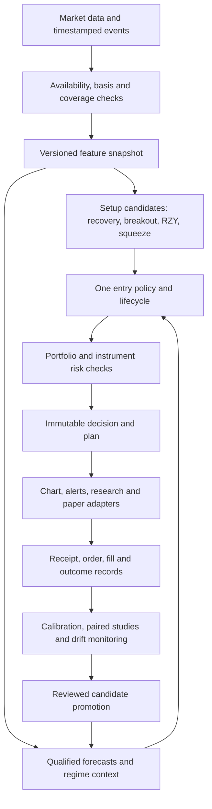
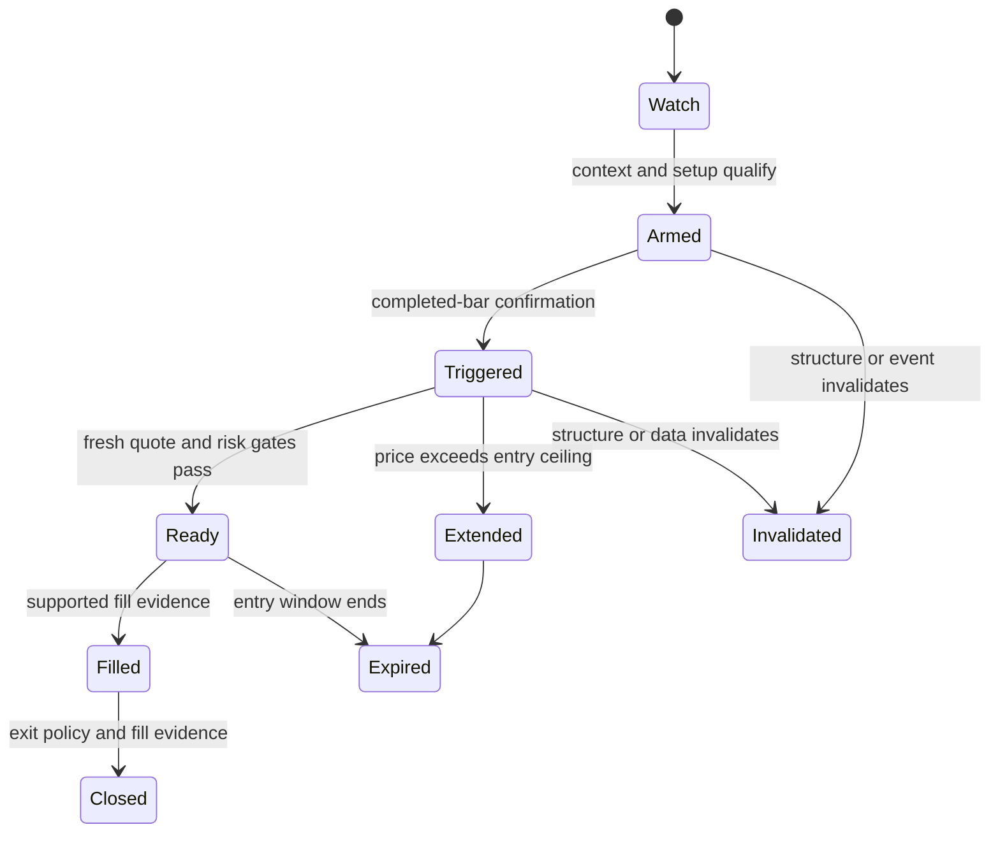

# Architecture and delivery plan

**Status: proposed, not implemented.** This plan extends existing signal occurrences, Intraday contracts, RZY workflows, measurement records and option snapshots. It does not authorize trading activation or replace the more detailed existing F03/F04 release requirements.

## Product decision

Use a single **Trade Readiness** presentation on stock detail and saved plans. Discovery tools may disagree, but there should be one explicit answer to “is this particular entry still valid?” Keep the distinction between a bullish stock and a timely, risk-qualified trade.

Example proposed card:

```text
ABC • Breakout retest • SWING • WATCH: waiting for reclaim
Setup: base breakout with first controlled pullback
Trigger: completed trigger-bar reclaim of 50.20; participation qualified
Entry range: 50.20–50.40     Invalidation: 49.40     Structural target: 52.80
Expiry: named session/time  Current price: 51.10 → too extended for this plan
Strength: 74/100            Target-before-stop probability: not established
Data: complete as of ...    Event risk: earnings in 2 sessions
Portfolio: ...              Action: wait for a new valid setup
```

Numbers are illustrative, not proposed universal parameters. The maximum entry is a constraint, not a broker order. Show the decisive blocker first, then expandable evidence, alternate scenarios and the exact saved policy/version. A plan becoming stale must not stay green because the last score was high.

## Architecture decisions

| Decision | Choice | Reason and tradeoff |
|---|---|---|
| Consolidation boundary | Shared contracts and pure calculations first; retain existing services | Removes semantic drift without a disruptive service rewrite |
| Entry authority | One pure versioned policy called by decision-engine and local fallback | Consistency and deterministic replay; migration needs behavior comparisons |
| Feature ownership | Data services own availability/basis; TA owns structure; ML owns forecasts; decision layer owns action eligibility | Prevents each UI/alert recalculating a different answer |
| Trade family | Separate daily setup, same-session setup, RZY strategy and options instrument | A horizon is not a strategy; a stock forecast is not an option return forecast |
| Storage | Extend existing immutable records with additive fields/tables only where needed | Avoid parallel competing histories and another generic event-bus rewrite |
| Unknown data | Explicit unknown with per-capability restrictions | Less apparent coverage, more trustworthy results |
| LLM role | Extract cited facts and explain deterministic decisions; no invented numeric confidence | Clear provenance and reproducible risk checks |
| Model promotion | Version-qualified candidate, controlled serving cohort, reversible selection | Slower than replacing files nightly, but protects evaluation integrity |
| UI learning | Refresh existing `/learn` and link specialist guides | No second disconnected education application |



Feedback never rewrites the original decision. Corrected-data replay is a separate run. The diagram is a logical data flow using existing services, not a proposal to route everything synchronously through another network hop.

## Contract design

These are conceptual fields to map onto current models before migration. Do not introduce another `Signal` table simply because these names differ from existing columns.

| Record | Minimum contents | Existing foundation |
|---|---|---|
| Evidence snapshot | instrument/venue/session, bar identities, price and volume basis, source event time, first availability, ingest time, decision cutoff, completeness, revision/hash | Input contract, price-basis/corporate-action evidence, Intraday inputs |
| Feature snapshot | snapshot ID; features with units/formula versions; source identities; VP range and VWAP anchor; RVOL baseline counts; missing reasons | Signal reasons, TA computations, Intraday input hashes |
| Setup occurrence | strategy/version, direction, horizon, known-at time, state, entry zone, stop, structural targets, expiry and replacement identity | SignalOccurrence/SignalSnapshot, RZY structures, Intraday setup records |
| Prediction | named target, forecast horizon/unit, probability or quantiles, model/calibrator/evaluation versions, qualifications, population and uncertainty | ML bundles, suppression inventory, calibration research |
| Decision | immutable snapshot references, resolved parameters/hash, gates and authority, eligible/blocked reason, portfolio snapshot and size constraints | Decision logs, shared metric contract, paper scan logs |
| Delivery/order/fill | separate identities; send content hash, recipient, attempt/fencing token, acceptance state; order-ready time; venue quote/fill evidence | Outbox/receipts, F03 plan, Intraday fills, broker records |
| Outcome | exact decision/receipt/order identity, target definition, maturity, price basis, net costs, censoring/nonfill/cancel state | Signal outcomes, Intraday outcomes, RZY journal, option captures |

All event timestamps are aware UTC with exchange session identifiers; user display can use local time. `known_at <= decided_at <= order_ready_at <= fill_at` is necessary but not sufficient: each consumed bar must also have been available before the decision. A row written later cannot backdate an actionable decision. Corrections retain the earlier observed value and the correction time.

Key invariants:

1. One saved decision points to immutable evidence and effective policy, including Redis override source/expiry. A UI refresh cannot alter it.
2. Data-ready, research-ready, notification-ready and execution-ready are distinct capabilities.
3. Missing qualified ML gives zero ML contribution and explicit unavailability. It does not silently widen new-entry eligibility. Keep the current fixed fallback behavior and qualify any changes.
4. An alert acceptance is neither inbox delivery nor a fill; a nonfill is neither a zero-return trade nor a loss.
5. A stock-day, repeated scan, setup, recipient and trade are different grains. Every metric declares its denominator.
6. Daily SHORT/SWING/LONG/GROWTH remain isolated from same-session INTRADAY. Do not reuse daily models as intraday forecasts.
7. A deterministic fallback uses the same policy artifact; unavailable mandatory evidence blocks new risk. Risk-reducing position management remains independently available.

## Early-rally entry design

### Lifecycle



An extended setup may generate a **new** retest occurrence when its predeclared rules qualify; it cannot reset the old trigger and erase a missed entry. For the chart, display `WATCH`, `WAIT FOR TRIGGER`, `READY`, `TOO EXTENDED`, `EXPIRED` and `INVALIDATED`. These are proposed labels, not claims about current UI states.

### Three research playbooks, introduced sequentially

| Playbook | Setup known before entry | Trigger | Invalidation and anti-chase |
|---|---|---|---|
| Base breakout and first retest | Prior base/compression, known resistance, stable liquidity | Completed break above resistance, then retest/reclaim with valid same-time participation | Below retest structure; expire if no timely retest; cap price distance from trigger |
| Early recovery | Higher low, reclaim attempt and improving sector-relative performance | Completed reclaim of a declared level with participation; no new lower low | Structural lower-low failure; no entry simply because RSI is low |
| Catalyst continuation | Material event known to the platform, bounded initial response and consolidation | First qualified continuation after response holds | Failed event level, contradictory correction, excessive extension or spread |

RZY is a candidate setup provider and comparison arm, not an extra mandatory vote. Squeeze ignition is a separately labeled high-risk subset with stale-short-data and halt/liquidity constraints. Do not combine all families into a universally permissive “early rally” rule.

Each family needs a fixed context timeframe and completed trigger timeframe. A swing setup can have a faster entry overlay, but the daily forecast remains daily. A same-session trade belongs to the separate Intraday contract. Pivot confirmation and event availability must be respected.

### Entry geometry and risk

For a long, predeclare structural stop `S`, realistic target `T`, minimum planned reward/risk `q`, estimated loss-side costs `cL` and reward-side costs `cW`, all in price-per-share units:

`net planned R/R = (T - E - cW) / (E - S + cL)`

The risk/reward-derived maximum entry is:

`E_max_RR = (T + q*S - cW - q*cL) / (1 + q)`.

Use the strictest of this bound, a volatility-normalized distance from the trigger, a session/anchor extension bound, and any liquidity/order constraint. Validate `T > E > S` and positive denominator. These boundaries are research parameters, not guaranteed loss caps. Do not move `T` farther away merely to force a passing ratio.

Size using the minimum of risk-budget shares, capital limit, liquidity limit and portfolio concentration limits; account for cash, FX, lot size and correlated holdings. A stop can gap, so normal stop-based size requires separate gap/event stress limits. [FINRA stop-order guidance](https://www.finra.org/sites/default/files/notice_other_file_ref/Regulatory-Notice-16-19.pdf).

High RVOL alone must never waive extension limits. An existing holding may continue to be managed after a new-entry window expires; “do not buy here” is not automatically “sell an existing position.”

## Prediction and confidence research

Start with the repaired current models and a simple baseline. Propose more complex forecasting only after demonstrating incremental value.

| Output | Exact question | Evaluation |
|---|---|---|
| Directional probability | Is the named price/return hurdle met at the declared horizon? | Brier/log loss, reliability plots, AUC/PR as appropriate, base-rate baseline |
| Entry success probability | After the specified entry convention, does target precede stop before expiry? | Chronological barrier labels, ambiguity policy, calibration and net expectancy |
| Return/risk distribution | What are plausible return, MAE and MFE ranges over that horizon? | Quantile loss, empirical coverage by regime and forecast date |
| Abstention/readiness | Is evidence sufficient for this forecast and this action? | Coverage versus error, stale/missing rates, blocked opportunity outcomes |

Do not present these four as the same “confidence.” Forecast intervals are not guarantees; assess empirical coverage and drift, especially across regimes.

Finish F04 before richer models: purge using actual label end times, preserve calendar/session semantics, keep cross-sectional dates grouped, fit transforms only on training data, and record the exact reporting population. Fundamentals, news, corporate actions and universe membership must be point-in-time. Random row splits and today's constituents reconstructed backward are insufficient.

A subsequent **entry-quality model** could estimate whether to take a specific setup, using extension, participation, structure, liquidity and event context. It should learn from all observed eligible setups, including rejected candidates under a predeclared counterfactual simulator, rather than only winners or fills. This is a research proposal, not a replacement for hard risk checks. Sparse regime/style cells should abstain or use explicitly validated pooling; do not manufacture cell-level certainty from small samples.

HMM should be tested as a context feature/size constraint against the simpler regime classifier. Compare changes in risk and decisions, not just state classification stability. A “bull” posterior does not establish positive expected return for every stock.

## Consolidation work packages

| Package | Primary owners | Concrete work | Preserved behavior |
|---|---|---|---|
| Volume/time contract | market-data, shared, frontend | Matched-session RVOL; named VWAP; completed-bar/coverage semantics; cached snapshots | Keep full-day ratio as a separately named measure |
| Structure contract | technical-analysis, frontend | FVG interval union/lifecycle; VP range identity; stable anchors; shared golden cases | Keep fixed/session/range profiles and chart controls |
| One entry policy | decision-engine, market-data | Extract deterministic evaluation, resolve parameters once, shadow old/new outcomes, explicit degraded mode | Existing portfolio risk constraints and position management |
| Evidence completion | signal-engine, shared, market-data | F03 receipt identity; F04 protocol; rejected-candidate records; policy snapshots | Legacy cohorts readable and clearly labeled |
| Event context | news/event/research services | Canonical event identity, revisions, expectation basis, observed-time reaction | Existing collectors, deduplication and budget accounting |
| Options decision | market-data, frontend | Underlying plan references, candidate quote age and scenario table, stock/no-trade comparison | Contract refusals, bounded shortlist, research-only labels |
| Learning/trust | frontend, docs | Refresh `/learn`; inline definitions; evidence drawer; capability status | Existing specialist guides and simple default view |

## Experiments and decision rules

Preregister candidate variants, universe, dates, costs, primary metric, minimum detectable improvement and stopping rules before examining evaluation results. Historical periods already studied are development data for future changes. Record every attempted variant to limit selection bias. Multiple searches can overfit even a nominal holdout: [Bailey et al.](https://www.davidhbailey.com/dhbpapers/backtest-prob.pdf).

| ID | Experiment | Baseline and primary comparison | Critical failure/control |
|---|---|---|---|
| E1 | Same-time RVOL | Current elapsed-threshold alerts vs qualified baseline, common opportunities | Missing sessions must not appear as extraordinary activity |
| E2 | Early entry | Current entry vs first retest/recovery, matched universe and time | Include nonfills, missed runners and higher failure rate from earlier entry |
| E3 | Anti-chase | Current policy vs one predeclared extension alternative | Report both avoided losses and foregone gains, including capital reuse |
| E4 | Evidence groups | Drop one group at a time from a frozen baseline | Price-derived indicators cannot claim independent lift by double counting |
| E5 | HMM | Existing rule regime vs rule regime plus HMM | No future-fit/smoothed states; include outages and transition periods |
| E6 | News response | Price/volume baseline vs timestamp-qualified catalyst context | Publication time cannot substitute for actual availability |
| E7 | RZY | Corrected causal baseline vs one sequence/entry variant | Fixed as-observed population; rebuilds cannot remove bad trades |
| E8 | Options | Supported structure vs stock and no trade at identical underlying opportunities | Bid/ask costs, expiry/assignment/capital, identical holding conventions |

Use paired date-block resampling and symbol sensitivity because repeated symbols and market days are dependent. Report gross and net results, adverse cost stress, cohort coverage and excluded/unresolved cases. Sample sufficiency depends on desired precision and effective independent dates, not an arbitrary number of scenario rows. A small UI sample floor is not a promotion criterion.

Metric definitions:

- **Net expectancy:** mean realized net R for filled trades; separately report expectancy per unique opportunity with an explicit no-fill/capital policy. Do not count the same setup every scan.
- **R:** net trade P&L divided by initial predeclared risk. A gap loss can be worse than −1R. Keep percentage return and R separate.
- **Entry quality:** MAE/MFE, entry extension, delay from first eligible trigger, target-before-stop rate, and missed-opportunity rate; use a frozen horizon. “Bought the top” requires an ex-ante measurable proxy, not hindsight peak selection.
- **Portfolio:** cash-aware net return, matched benchmark/exposure, turnover, drawdown and recovery duration, sector/correlation concentration, tail stress. Trade win rate alone is inadequate.
- **Trust:** reliability by named event and horizon, observed-versus-forecast rates, unresolved fraction, data coverage, quote age, and fallback rates.
- **Operations:** latency distribution with denominator and missed/expired opportunities, not only mean runtime of successful scans.

For strategy promotion, require a predeclared economically meaningful net improvement with uncertainty and drawdown/cost constraints, stable across relevant date segments, then a forward shadow phase. If results are inconclusive, retain research status. Correctness fixes can ship with deterministic and integration proof even when future return improvement is unknown.

## Delivery sequence and acceptance gates

Effort estimates below are relative planning units, not calendar promises: S = localized, M = several cooperating paths, L = multi-service/evidence work. Forward measurement requires actual elapsed market sessions and label maturity.

| Phase | Effort | Deliverable | Release/activation gate |
|---|---|---|---|
| 0. Pin evidence | S | Source/runtime inventory, capability map, current settings, data/latency/verified-outcome baseline | Read-only production capture with identities and explicit unknowns; no performance baseline inferred from this audit |
| 1. Repair meaning | M | FVG fix; VWAP/RVOL definitions; squeeze field validation; HMM correctness; learning corrections | Reproduction witnesses become regressions, real calculation parity, targeted suites; score changes separately versioned |
| 2. Finish evidence | L | Existing F03 receipts and F04 evaluation/publication controls; immutable policy/rejection records | Actual DB concurrency/migration tests, serving/fallback replay, no leaked labels, exact attribution; follow existing detailed gates |
| 3. Consolidate policy | L | Shared evaluator and Trade Readiness presentation | Identical frozen-input decisions across adapters; all intentional differences named; risk-reducing exits survive outages |
| 4. Early-rally shadow | M/L | One playbook initially, completed-bar trigger and entry ceiling, causal fills | Data availability/latency qualification; no producer enabled merely because Stage C tables exist |
| 5. Prediction/return studies | L plus market time | Qualified calibrators, ablations, portfolio and options comparisons | Preregistered unseen evaluation and forward evidence; publish failures and uncertainty |
| 6. Expand selectively | Variable | Only proven additions, with monitored rollout and rollback | Per-cohort capability, economics and operational gates; no automatic real-money activation |

Parallelizable *work*, without requiring multiple agents: contract documentation, learning content and deterministic correctness tests can precede production measurement. Do not hold FVG status repair hostage to an HMM study. Do not use a correctness-only release to smuggle in lower trading thresholds.

Release mechanics: additive schema first with old readers compatible; defaults off for new producers; shared-consumer image parity; exact source/policy/model identities; migration locks; rollback images and last qualified model; staged cohorts. Disabling a feature does not close existing positions. Preserve the existing deployment/backup lock and measure host load before widening scans.

## New features worth building—and what to defer

1. **“Why wait?” and “What changes this decision?”** Show the exact missing trigger, entry ceiling, expiry and data blocker. High user value without pretending to predict a top.
2. **Evidence drawer.** One click reveals source age, completed/forming basis, definition of probability, sample window and authoritative policy.
3. **Rejected-setup journal.** Review valid blocked opportunities and late alerts alongside trades, with the frozen reason and realistic counterfactual.
4. **Post-entry quality review.** Compare actual fill with planned entry; separate poor selection, late entry, costs and exit behavior.
5. **Scenario-based instrument comparison.** Compare stock and supported options for the same plan, including price up/flat/down, IV change and elapsed time.
6. **Point-in-time event surprise and response.** Research only when timestamped estimates/availability exist; otherwise preserve an explicit unknown.

Defer another composite “super score,” reinforcement-learning execution, deep models per thin-data ticker, order-flow/footprint claims from OHLC bars, and automated complex options. None addresses the verified foundations better than the plan above.

## Learning-page integration specification

Use [learning-guide.md](learning-guide.md) as the content source for a future `/learn` refresh: Start Here → Scores and Trust → Rally Entries → Chart Tools → RZY/HMM → Events/Squeezes → Options → Journal/Review. Reuse existing option/squeeze specialist pages through links. Add worked-example inputs and revealable answers; examples must be marked hypothetical and never use current prices as trade instructions.

Acceptance: every requested feature has a plain-language explanation, where to find it, a worked interpretation, a failure case and a link to deeper evidence. Navigation and selected horizon remain visible. Capability badges reflect backend state rather than hard-coded claims of validation. This documentation release creates the wiki only; it does not implement those UI changes.
