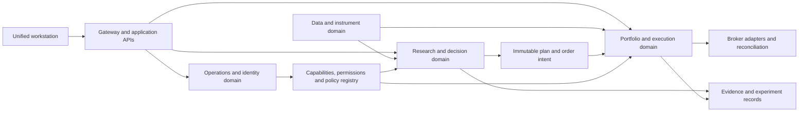

# Consolidation blueprint

**Proposed architecture; no code changes.** Companion to the [whole-platform review](platform-review.md). Consolidation has three separate meanings: simplify user destinations, unify business definitions, and reduce technical duplication. They should not be implemented as one large rewrite.

## Consolidation rules

1. Preserve distinct questions even when they share a page. A valuation scenario, directional forecast and entry trigger must not become one score.
2. Preserve distinct ledgers even when they share a screen. Paper execution, broker-confirmed execution and manual holdings must remain identifiable.
3. Preserve specialist capabilities. Remove duplicate computation/navigation, not useful analytical depth.
4. Consolidate behind adapters before deleting old paths. Migrate saved links, preferences, alerts and historical records explicitly.
5. Shadow-compare decision changes on frozen inputs. Pure navigation moves should not alter trading policy.
6. Use one owner per domain concept. Shared schemas/fixtures may be sufficient; a new microservice is not automatically required.

## Page-to-workspace map

Proposed primary destinations: **Today, Discover, Research, Trade, Portfolio, Review**. Search, notifications and Learn remain globally available; Settings and Operations are secondary/role-aware. “Research” opens the selected instrument's dossier when a symbol is active and the research library otherwise.

| Current surfaces | Proposed home | What changes | What stays distinct |
|---|---|---|---|
| `/`, `/market-pulse-dashboard`, `/heatmap`, `/regime`, `/sector-rotation` | Today → Market | One market brief, change feed and expandable context panels | HMM versus simpler regime, market and session scope |
| `/rankings`, `/screener`, `/market-screener`, `/opportunities`, `/watchlist` | Discover | Shared candidate table, saved screens, filters and list actions | Internal covered universe versus external discovery; coverage/entitlements |
| `/compare`, `/analyst`, `/stock-intelligence` | Research → Overview/Peers | Reusable instrument dossier/peer comparison | Analyst opinion versus measured facts |
| `/stock/[symbol]` | Research ↔ Trade instrument workspace | Preserve deep link; context-aware tabs and selected plan | Research mode versus execution-capable mode |
| `/research`, `/research/[symbol]`, `/intelligence-reports`, `/reports` | Research → Library and dossier | One report catalog with type, as-of, version and evidence | Model narrative, deterministic report, archived report, current facts |
| `/quality-value`, valuation report tabs | Research → Company/Valuation; Discover preset | Unified scenario viewer and coverage summary | Screening proxy versus qualified valuation; sector-specific applicability |
| `/news`, `/intelligence`, `/earnings`, `/fed-watch`, `/connections`, `/insider`, `/congress` | Today → Events; Research → Timeline | One event identity with multiple views/filters | Disclosure date, underlying transaction date, observation date; macro vs issuer |
| `/short-squeeze`, `/short-selling` | Discover → Crowding preset; Research → Positioning | Shared short-data panel and squeeze watchlist | Short-interest snapshot, borrow inventory, daily short volume |
| `/options-flow`, `/options-flow-alerts`, `/options-income`, `/options-calculator` | Trade → Options | One underlying-first options desk, flow tab, structures, scenario calculator | Flow direction inference, structure suitability and actual trade economics |
| `/little-rzy`, stock RZY overlay | Research/Trade → Setups | Strategy selector with consistent state/explanation | RZY research identity, confirmation delay and result cohort |
| `/decide`, game plans, position sizer, FVG plan | Trade → Selected Plan | One entry authority and risk sizing pipeline | Alternative plans available for comparison but not simultaneously authoritative |
| `/board`, `/conditional-orders` | Trade → Plans/Orders | Plans progress through explicit lifecycle to supported order intents | Saved plan, condition armed, pending intent, broker order and fill |
| `/positions`, `/portfolio`, `/paper-portfolio`, `/etrade-transactions` | Portfolio → Holdings/Activity/Accounts | One account-aware view with reconciliation status | Live, sandbox, paper and manually tracked books |
| `/alerts`, `/risk-alerts`, signal/squeeze/flow subscriptions | Global Inbox + Manage Alerts | Unified notification preferences, lifecycle and material-change policies | Source-specific thresholds and permissions |
| `/journal`, `/trade-performance`, `/watchlist-performance`, `/signal-accuracy`, `/squeeze-alert-performance` | Review → Decisions/Performance | Cohort-aware scorecards and decision replay | Signal outcome, delivered alert, simulated fill, broker-confirmed trade |
| `/strategies`, `/backtest-results` | Review → Research Lab | Versioned hypothesis/experiment workflow | Research versus eligible strategy publication |
| `/signal-quality`, `/signal-filters`, `/signal-tuning`, `/horizon-compare`, `/paper-gates` | Operations → Decision/Model Quality | One diagnostics console | User performance views versus privileged policy controls |
| `/admin-health`, `/data-pipeline`, `/admin-signals`, `/admin-ai-features`, `/fix-effectiveness`, `/improvements` | Operations | Capability health, jobs, releases and issue tracking | Runtime controls, read-only evidence and engineering backlog |
| Guides and playbooks | Learn + inline contextual help | Searchable curriculum and tool-specific entry points | Educational examples versus actionable current plans |
| `/settings`, login/gate, session changelog | Account/Settings; change history | Consistent identity/account/environment controls | Authentication boundary versus feature entitlements |

This is an information-architecture mapping, not permission to remove routes. Old URLs initially redirect or render the corresponding new tab while preserving relevant query parameters. Role restrictions remain server-enforced. Move paper tools out of an admin-only navigation bucket only when backend permissions safely support the intended audience.

## Business concepts to unify

| Concept | Current overlap | Canonical owner/contract | Migration check |
|---|---|---|---|
| Instrument identity | Symbols used across price, event, options and broker paths | Market-data instrument master with internal ID, venue, currency, aliases and effective dates | Same ticker on different venues, rename, delisting, class shares and option underlying |
| Session/time | Scheduler helpers, input contracts, charts and strategy windows | Shared calendar/session and availability contracts | US early closes/DST, HK lunch, future/forming bars, calendar coverage expiry |
| Market state | Rule regime, HMM, market dashboards and local fallbacks | Versioned market-context snapshot with separate component outputs | No forced conversion of HMM posterior into a trade probability |
| Volume | RVOL, full-day ratios, volume z, alert approximations | Shared volume feature snapshot with explicit denominators | Fixtures and live/as-of parity; incomplete baseline cannot pass as complete |
| Structural levels | TA/FVG/chart VP/server VP/manual anchors | Level record: method, range, known-at, basis, version, lifecycle | Chart/alert agrees when inputs and method match; different ranges remain named |
| Prediction | ML probability, fused signal, confidence, confluence | Typed score/prediction registry | Same target/horizon required for comparisons; no mixing score and probability |
| Entry decision | Decision-engine, paper fallback, condition actions and plan previews | One pure policy evaluator with explicit action/capability | Same decision on frozen input; equivalent mandatory gates on every entry adapter |
| Sizing | Position-sizer preview, paper sizing, plan/option collateral | Risk-budget service/module with explicit instrument and account inputs | Lot size, FX, cash, stop gaps, multi-leg exposure, reservations |
| Event | Headlines, filings, earnings, hot flags and report connections | Event-intelligence identity with news ingestion adapters | Dedup without discarding corrections; observed-time causality |
| Financial fact | Vendor fundamentals, filings, report quantities, valuation inputs | Issuer fact store with unit/period/source/available-at | Conflicting periods/units and revisions remain visible |
| Outcome | Signals, alert outcomes, paper/broker trades, options studies | Shared outcome vocabulary and study contract, domain-specific records | Named grain, target, prices, costs, maturity, nonfills and unresolved exposure |
| Capability | Feature flags, entitlement, disabled producers, static UI tags | Capability registry + permission layer | Deployment/enabled/evidence-ready are separate; unknown fail-state declared |
| Notification | Signal/news/risk/flow/squeeze senders | One delivery/outbox contract with source-specific policies | Idempotency, preferences, unsubscribe, recipient ownership, unknown acceptance |
| Research artifact | Reports, model files, calibration results, backtests | Versioned artifact manifest with lineage and access rules | Prior evidence immutable and replayable; latest does not overwrite history |

“One owner” does not mean every read becomes a synchronous network call. Publish/cache a versioned snapshot and let consumers read it consistently. Cache keys must include instrument/venue, horizon, account/user when appropriate, policy version and data identity; a timestamp-only cache invalidation is insufficient for corrected histories.

## Service/module target

Keep the current deployment initially. Organize source into bounded modules and APIs so future splitting or combining is deliberate.

| Domain | Existing implementations | Refactor direction |
|---|---|---|
| Data/instruments | market-data ingestion/routes, shared prices/calendar, option-chain providers | Separate provider adapters, normalization, validation and read models; bounded queries and rate budgets |
| Indicators/setups | technical-analysis, shared indicators, RZY and chart calculations | Pure calculations with fixture parity; retain distinct strategy state machines |
| Ranking/signals/decisions | ranking-engine, signal-engine, decision-engine | Keep different responsibilities, unify snapshot/qualification and final entry authority |
| Predictive research | ml-prediction, strategy-engine, calibration/measurement studies | Common experiment manifests and evaluation contracts, separate job workers |
| Issuer/event research | research-engine, event-intelligence, news-intelligence | News owns collection; events own event identity; research owns orchestration and explanation |
| Portfolio/execution | paper engine, broker adapters, conditional orders, optimizer | Extract account book, order lifecycle, reconciliation and risk evaluation from broad paper module |
| Delivery | scheduler jobs, outbox/email/push | Scheduler orchestrates small jobs; durable worker owns delivery lifecycle |
| Platform | gateway, auth, budgets, capabilities, deploy/backup | Explicit control plane and audit trail; service-specific least privilege |

No immediate recommendation to merge ML/ranking/signals into one service, or to split every domain into a new service. Shared calculations can be packages; deployment splits should follow measurable resource/availability needs. Prevent circular imports and cross-domain direct writes through narrow interfaces and ownership checks.

## Proposed canonical records

Reuse existing models where semantics match; this is a target conceptual model, not a prescribed new table for every row.

| Record | Identity and invariant |
|---|---|
| Instrument/alias | Internal immutable ID; symbol/venue/currency and aliases valid over time |
| Evidence revision | Source identity, source event time, available-at, recorded-at, basis and content hash |
| Research thesis | User/team owner, instrument, scenario, supporting/counter evidence, invalidation and version |
| Setup occurrence | Strategy/horizon/version, first known time, immutable trigger context and lifecycle |
| Plan version | Selected setup/evidence, account/environment, entry/stop/target/expiry and resolved policy |
| Order intent | Durable client identity, plan version, risk authorization/reservation and dispatch state |
| Broker order/execution | Broker account/order/execution identifiers; partial fills and corrections append history |
| Portfolio ledger | Cash/asset movements, fees, FX, transfers, corporate actions and reconciliation lineage |
| Position projection | Derived account holdings as of a declared event/cutoff, with broker comparison |
| Outcome/study | Exact target/cohort/horizon/cost convention, maturity and coverage |
| Audit event | Actor, subject, action, before/after references, reason, request/trace ID and result |

A consolidated ledger should eventually support reproducible accounting entries, but implementation can begin with normalized immutable execution/cash events and deterministic projections. Do not replace a broker's legally authoritative records with inferred chart fills. A missing broker event is an exception to resolve, not permission to manufacture a balancing entry.

## Alert and refresh consolidation

One event can affect several views without creating several independent alerts. A material earnings event might update the dossier, invalidate a plan and warn a held position; preserve those consequences but group them under one event in the inbox.

Notification policy includes priority, affected account/holding/plan, source, required freshness, deduplication identity, delivery channel, trading-session preference, quiet hours and expiry. Risk notifications must not be silently suppressed by a research digest preference. Acknowledgment means read/accepted by the user, not that an order was placed.

Replace ambiguous Refresh / Refresh Signal / Full Refresh choices in the ordinary workspace with **Refresh view**, showing last successful refresh and stale components. Put expensive ingest/recompute/retrain actions behind separately named operations controls with cost/impact. Refreshing a quote must not regenerate a saved decision or spend money unexpectedly.

## Data and computation cost consolidation

- Fetch a provider snapshot once per declared scope/cadence and reuse it across readers, preserving provider attribution and usage rights.
- Coalesce duplicate pending work by instrument/horizon/version; bound queues and expire late setup work.
- Keep price/order monitoring in a higher-priority worker pool than report generation, history backfills and ML fitting.
- Batch independent database reads; avoid one per-symbol provider/database round trip per widget when a shared read model suffices.
- Cache expensive deterministic computations by input hash; invalidate on revision, not merely elapsed TTL.
- Use existing LLM reservations/budgets. Separate mandatory risk/data processing from optional narration when budget is exhausted.
- Measure per-feature provider calls, CPU time, storage growth, token spend and user usefulness before buying another feed or adding infrastructure.

## Safe migration procedure

1. Inventory the current endpoints, data ownership, job writers, permissions and callers for one domain.
2. Freeze fixtures and representative snapshots, including failures and unknown states.
3. Introduce the canonical contract and adapter without changing current behavior.
4. Compare old/new reads and decisions, with explicit expected differences and attribution.
5. Roll out the new UI or consumer to a bounded cohort; retain old URLs and data views.
6. Migrate durable state idempotently, with counts and semantic reconciliation. Quarantine records whose lineage cannot be inferred.
7. Disable old writers before deleting them. Verify no scheduler/manual/API path can revive them.
8. Retire code only after observed caller migration, rollback testing and historical-read preservation.

Dual-write does not imply two order senders, two alert senders or two policy authorities. Only one side may perform external effects. Shadow comparison records decisions without creating orders or emails.

## Consolidation success criteria

The platform should have fewer places to make the same decision, fewer contradictory values and fewer duplicate jobs. Track task completion/time, context switches, duplicate alerts, decision mismatches, unsupported/unknown inputs, provider-call savings and failure isolation. Do not claim success merely because lines of code, pages or services decreased.
