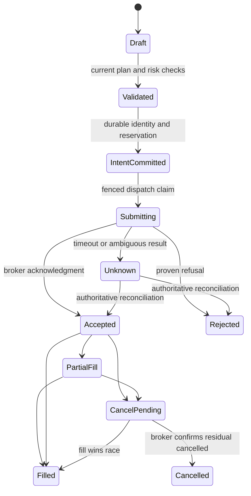

# Institutional controls, feature priorities and delivery roadmap

**Proposed target and implementation backlog. No activation or code change.** Read alongside the [platform assessment](platform-review.md), [consolidation map](consolidation.md) and [experience specification](experience-design.md).

The initial target is institutional-quality operation for the platform's existing investment scope, not exchange-grade latency or a regulated multi-asset institution. Controls scale with actual use: a single-user research tool does not need the same approval hierarchy as a team managing client accounts. Correct accounting, honest evidence and safe external effects matter in either case.

## Non-negotiable system properties

1. Every material decision can be reconstructed from the evidence and policy available then.
2. Every live order has durable local intent, a stable identity and an explicit reconciliation path.
3. Unknown broker status retains potential exposure; it is never treated as definitely rejected or automatically resubmitted.
4. Account/environment/permission scope is enforced on the server at every write, not inferred from the menu.
5. Risk covers existing positions, pending orders, reservations and supported derivatives; missing coverage is visible.
6. A feature is labeled according to implementation, deployment, activation and evidence readiness separately.
7. Failure of research, ML or notifications cannot prevent independent position-risk management.
8. Recovery restores decision/account consistency and reconciles external effects before execution resumes.
9. User education and UI copy cannot claim stronger predictive evidence than the system possesses.
10. External data and model usage obey the actual entitlements and retention conditions; adding a provider API is not proof of redistribution rights.

## Control catalog

| ID | Control and design | Acceptance evidence |
|---|---|---|
| IC01 Identity/session | Revocable sessions, secure token handling, step-up for privileged/live actions, separate actor/subject during impersonation | Old tokens fail after revocation across gateway/backends; current session rotates safely; impersonation cannot inherit unapproved execution authority |
| IC02 Authorization | Capability/role/account permissions, explicit service scopes, owner checks for objects and exports | Negative cross-user/account tests; disabled/tier changes enforced server-side; no hidden-route bypass |
| IC03 Secrets | Separate signing/encryption keys, key IDs/rotation, least-privilege decryption, redacted logs and exports | Legacy credential inventory and migration proof; rotation/rollback tested without exposing secrets |
| IC04 Instrument/data | Internal instrument identity; source/time/basis/revision/entitlement; freshness and coverage gates | Venue/alias/rename/corporate-action fixtures; immutable as-observed replay; provider disagreement handled |
| IC05 Model/research | Model/experiment registry, versioned evaluation, candidate isolation, promotion and rollback | Existing F04/F03 gates completed; label-time tests; serving cohort proof; drift and unknown-model handling |
| IC06 Pre-trade risk | Order-price bounds, cash/buying power, aggregate gross/net/sector/factor exposure, liquidity and event limits | Concurrent entry/conditional/API paths cannot oversubscribe capital; unknown positions remain reserved |
| IC07 Order lifecycle | Durable intent before send; broker-specific client ID; partial fills, reject/cancel/replace and unknown states | Crash and timeout fault injection around every provider boundary; no blind unknown retry; reconciled broker/local totals |
| IC08 Post-trade risk | Independent position monitor, stale-data policy, gap/volatility/assignment stresses | Training/news outages do not stall monitoring; alerts have complete coverage and latency denominators |
| IC09 Accounting | Immutable execution/cash/corporate-action events, projections by account/currency, reconciliation | Broker statement/position/cash differences resolved with evidence; fees/transfers/FX correct; manual edits append history |
| IC10 Notification | Unified source event + delivery identities, preference/consent recheck, deduplication, expiry and unknown acceptance | Retry/receipt concurrency, user isolation, unsubscribe and outdated-plan tests |
| IC11 Audit trail | Actor/action/subject/reason, immutable references, event time and request identity | Sensitive changes and external effects trace end-to-end; retention and access policy tested; hashes not misrepresented as tamper-proof storage |
| IC12 Resilience | Capacity isolation, timeouts, bounded retries, backpressure, dependency-specific degraded modes | Busy training/backfill cannot starve account monitoring; queue age and dropped/expired work observable |
| IC13 Recovery | Independent encrypted backups, restore verification, qualified model/policy recovery and broker reconciliation | Full isolated restore drill, measured RPO/RTO, no automatic replay of external effects after recovery |
| IC14 Release | Locked dependencies/images, migrations, SBOM/advisory checks, staged cohorts, rollback and source parity | Clean candidate tested in actual runtime; required PostgreSQL tests cannot silently skip; restored rollback validated |
| IC15 UX/accessibility | Persistent context, clear states, readable default workflow and keyboard/mobile support | Representative task tests and accessibility checks; stale/unknown/error distinct from success |
| IC16 Data/AI governance | Provider usage/retention register, LLM budgets, grounded claims, no document-driven instructions | Unauthorized data not exported; budget exhaustion degrades narration honestly; adversarial evidence/draft tests |

Use [OWASP ASVS](https://asvs.owasp.org/) for security verification and the [NIST AI RMF](https://airc.nist.gov/airmf-resources/airmf/5-sec-core/) to organize AI governance and measurement. These are reference frameworks, not an assertion of certification or legal compliance. Retention, reporting, best-execution and supervisory obligations depend on actual business/jurisdiction and require a separate qualified assessment if the platform expands to serving others.

## Portfolio and execution design details

### Account truth and risk

Use a canonical account/book identifier for every position, cash balance, order, plan and risk result. Keep base-currency reporting separate from native-currency cash/asset units. Economic exposure includes open positions plus plausible pending/unknown orders and unsettled obligations. Netting requires known contract/underlying relationships and supported risk assumptions.

For options, begin with supported stock options and transparent scenario aggregation; distinguish delta-equivalent exposure from nonlinear stress. Do not pretend delta alone captures gap/volatility/expiry/assignment risk. Mixed US/HK portfolios need FX and session-aware analysis; the current risk/stress routes' benchmark selection by strict HK symbol-count majority is not an exposure-weighted portfolio benchmark.

Risk results declare **covered exposure / total exposure**, data cutoff, asset limitations and chosen benchmark. Unsupported signed weights must be rejected or explicitly supported; `abs(weight)` must not silently transform a hedge into a long. Historic correlations and VaR remain estimates, supplemented by named stresses and liquidity constraints.

### Order states and reconciliation

This is a target state model; adapt existing states without rewriting history. Cancelled residual quantity does not erase earlier fills. A cancellation request is not cancellation confirmation. Replace orders require parent/child identities and exposure accounting across the overlap. Exactly-once external execution cannot be promised merely by a local lock or outbox; broker identity support and reconciliation bound ambiguity.

### Kill switches

Provide separately permissioned controls for **pause new entries**, **pause a strategy**, **pause a broker/account**, and **request cancellation of open entry orders**. Each states whether exits/protective orders continue and what unresolved orders remain. Emergency liquidation is a distinct action with market/liquidity implications; it is not the default effect of disabling automation.

Changes require audit identity/reason, reauthentication where appropriate and clear current state. Single-user operation can use deliberate confirmation; team operation may later require separate proposer/approver roles. Do not add approval friction to routine read-only research.

## Research, AI and feature governance

Create a registry entry for each decision-relevant capability: owner, purpose, markets/instruments, data/provider requirements, formula/model version, known limitations, evaluation protocol, activation, rollback and monitoring. Store policy/model changes as immutable versions with effective times.

Every research experiment includes hypothesis, candidate universe known at the time, input revisions, costs, trial count, label/holding semantics, development and untouched evaluation periods, and failure criteria. Report both statistical uncertainty and practical return/risk tradeoffs. Keep negative and inconclusive experiments searchable so a later session does not rediscover them as novel ideas.

Copilot and reports use typed evidence/claims and deterministic rendering for financial quantities. Evidence citation checks are not proof of causal truth; factual contradiction, stale context and speculative inference still need explicit treatment. Budget limits and provider failures produce a transparent partial response, not invented numbers or a hidden fallback to lower evidence standards.

No model, indicator or novelty gets priority simply for being more advanced. A simpler feature that improves calibrated decisions or reduces execution mistakes is preferable to an unqualified “AI institutional score.”

## Reliability targets and infrastructure sequence

Set targets after measuring current production. The following are **provisional planning objectives**, not current SLAs:

| Capability | Initial objective to validate | Measurement |
|---|---|---|
| Core authenticated read APIs | 99.9% availability during declared supported sessions | End-user request success, excluding only explicitly declared maintenance; failures/timeouts included |
| Common warm views | p95 server response below 1 second on an agreed representative load | Separate network/render cost and cold computation; never hide stale data to meet latency |
| Bar-driven setup | Complete processing before its declared entry window becomes invalid | Close → availability → processing → decision/receipt, with missed opportunities counted |
| Position/order monitoring | Cadence/freshness derived from actual strategy risk and broker/provider limits | Worst gap and p95/p99 delay, not only successful job duration |
| Research-only recovery | Candidate RPO ≤24 hours, RTO ≤4 hours | Isolated restore with artifacts and accounts reconciled; confirm suitability before adoption |
| Live decision/account recovery | Candidate RPO ≤5 minutes, RTO ≤60 minutes; brokers may still be unavailable | Durable order records, external reconciliation and supervised resume; stricter targets if strategy requires them |

Do not activate minute-scale execution where provider finality/delay cannot satisfy the strategy's window. RTO for platform restoration is not a promise that a broker or exchange will accept orders within that time.

Infrastructure progression:

1. Measure critical-path latency, CPU/memory, database locks/pools, disk/IO, provider quotas, queue age and data coverage.
2. Isolate critical account/risk workers from ML/reports/backfills with separate process pools and resource budgets. Coalesce redundant work.
3. Establish one migration job and compatibility checks; reduce startup DDL responsibilities safely.
4. Establish independent backups and tested recovery. For tighter RPO, evaluate WAL archiving/base backups or a managed database with PITR; [`pg_dump` alone is not WAL-based point-in-time recovery](https://www.postgresql.org/docs/16/continuous-archiving.html).
5. Move database or heavy workers to independent failure/resource domains when measurement and recovery needs justify the cost. Add read replicas/object storage only with clear usage.
6. Consider orchestration/streaming infrastructure only when service count/load/reliability needs exceed the simpler deployment model. A multi-container system on one host still shares host failure risk.

Cost accounting should show provider, compute, storage and LLM spend by feature/job, plus useful completed tasks. Model training cannot consume the budget or capacity reserved for risk monitoring.

## Prioritized implementation backlog

Effort: S localized; M several paths; L multi-service; XL sustained infrastructure/accounting program. These are sizing categories, not promised dates. Owners name code domains, not assigned individuals.

| Priority / ID | Deliverable | Owner | Effort | Depends on / acceptance |
|---|---|---|---|---|
| P1 / I01 | Production capability, flag, dependency and recovery inventory | Platform/operations | S–M | Exact source/runtime identities, no secrets in output, all unknowns assigned |
| P1 / I02 | Self-password-change revocation and session lifecycle | Auth/frontend | M | Cross-backend old-token rejection, safe current-session renewal |
| P1 / I03 | Signing/encryption key separation and privileged-action design | Auth/broker/platform | M–L | Legacy row inventory, rotation/recovery and scoped access tests |
| P1 / I04 | Supported patched dependency baseline and advisory gate | Frontend/platform | M | Current official advisories, lockfile/image parity, functional/security regression |
| P1 / I05 | Qualify durable broker submission and unknown-order handling | Execution | L | Runtime activation inventory, sandbox fault tests, broker-specific IDs, exposure reconciliation |
| P1 / I06 | Risk endpoint scope correction and coverage reporting | Portfolio | M | Signed-input policy, missing exposure tests, explicit limits/benchmark |
| P1 / I07 | Trading correctness and evidence repairs A01–A10 | Data/TA/signals/ML/decision | L | Existing detailed F03/F04 plans plus targeted source defects; no weakened gates |
| P1 / I08 | Restore drill and unified backup ownership | Operations | M | Independent copy, recovery evidence, broker resume procedure |
| P2 / I09 | Six-workspace shell and context preservation | Frontend | M–L | Read-only prototype/task validation, old deep links and permissions preserved |
| P2 / I10 | Selected-plan identity and one entry policy | Decision/execution/frontend | L | Shadow parity across UI, conditional orders, paper and supported live adapters |
| P2 / I11 | Canonical account events/projections and exception desk | Portfolio/execution | XL | Broker/cash/fees/FX/corporate-action reconciliation, signed coverage |
| P2 / I12 | Unified event/alert inbox and preferences | News/event/delivery/frontend | L | Exact source/receipt identity, consent, expiry, dedup and outage behavior |
| P2 / I13 | Instrument/evidence/feature contracts and registry | Data/shared | L | Point-in-time aliases/basis/coverage; chart/API/alert fixture parity |
| P2 / I14 | Basic Learn access, contextual help and status-aware copy | Frontend/docs | M | All requested tools covered; unknown/research status accurate; no entitlement bypass |
| P2 / I15 | Critical worker isolation and one migration owner | Platform/data | L | Contention/load tests and safe additive migration rollout |
| P2 / I16 | Decision replay, execution quality and cohort performance | Analytics/research | L | Real timestamps/costs, unresolved/nonfills, cash-aware portfolio results |
| P3 / I17 | Early-rally playbooks and qualified entry-quality model | Research/ML | L plus market time | Preregistered unseen and forward net benefit after foundations |
| P3 / I18 | Options scenario/risk integration | Portfolio/options | L | Supported contract terms, aggregate nonlinear scenarios and assignment handling |
| P3 / I19 | Research collaboration and review roles | Platform/research | M–L | Only if multiple users need shared work; explicit permissions/history |
| P3 / I20 | New feeds/asset classes/execution methods | Domain-specific | Variable | Demonstrated user/edge need, entitlements, storage and complete lifecycle/risk support |

The basic teaching, navigation prototype and read-only capability displays can progress while deeper execution work is underway. Live activation cannot borrow acceptance from a UI-only release.

## Delivery phases

### Phase A — establish truth and close reliability gaps

I01–I08, with separate small correctness releases where appropriate. Pin the release, record existing unknowns, repair session/security/risk semantics and existing trading defects, and prove recovery/order boundaries. Exit: current capability map is trustworthy, critical defects have verified remediation, and no “installed” feature is called enabled without runtime evidence.

### Phase B — simplify the user journey without changing trading policy

I09 and I14, plus read-only capability/evidence panels. Prototype the six workspaces using existing components and test real tasks. Migrate navigation and saved preferences incrementally; keep old links. Exit: fewer context switches, clear account/horizon/status, correct permissions and no trading behavior drift.

### Phase C — unify decisions, accounts and event delivery

I10–I13 and I15. Introduce canonical contracts and adapters, shadow comparisons, a single effect-producing writer, explicit portfolio coverage, and independent critical workers. Exit: deterministic replay/parity, reconciled account state, tested outage behavior and clear fallback policy.

### Phase D — measure and improve investment outcomes

I16–I18 and the previous audit's experiments. Research early entries, model/calibration additions and instrument choices on qualified evidence. Exit: results meet predeclared economics/risk criteria or remain research-only. A negative result is a useful outcome and must remain documented.

### Phase E — expand only where justified

Team collaboration, additional data, account scale or assets. Evaluate marginal value and operational burden before committing. Each new asset requires data identity, valuation, risk, execution, accounting, education and recovery support—not just a quote widget.

## Release and acceptance checklist

For each release, produce a small reviewable record: problem and changed behavior; applicable source/data/policy versions; tests actually run and skips; schema compatibility; affected capability states; runtime flags; rollback; observation period and owner. Do not recycle prior test counts as fresh evidence.

Required evidence depends on impact:

- **Prose/navigation:** link/accessibility/task checks, route compatibility, no policy changes.
- **Calculations:** hand-computed and property/edge fixtures, cross-language parity, missing/zero/nonfinite/unit checks.
- **Persistence/concurrency:** actual PostgreSQL transactions, races, retries, duplicate delivery and migration/rollback tests.
- **Broker/external effects:** sandbox and fault-injection scenarios around acceptance, partial fills and reconciliation; real-money enablement is separate.
- **Models/strategies:** point-in-time data, label separation, candidate isolation, evaluation protocol, economic comparison and qualified promotion.
- **Infrastructure/security:** installed-version scan, authorization negatives, load isolation, restore and key-rotation drills as applicable.

## Definition of success

The user can find an opportunity, understand the evidence, create a conditional plan, see its risk and expiry, and later reconstruct the result without reconciling contradictory screens. Operators can identify a stale feed, unknown order, risky concentration or failed backup before it becomes invisible exposure. Researchers can demonstrate incremental net benefit—or clearly say it is not established.

That is the institutional standard this roadmap targets. Feature breadth is valuable when every important feature participates in that coherent, reliable workflow.
