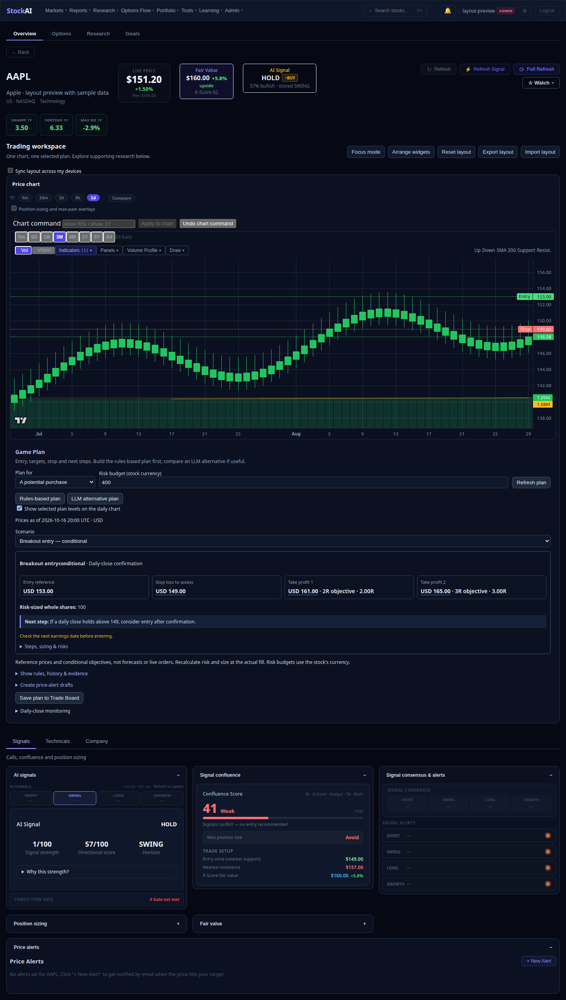

# Chart and Game Plan workspace

Release `5ab91daa` was committed, deployed and pushed to GitHub on October 18, 2026.

The stock page now opens with a full-width price chart and an attached Game Plan.
The plan shows one scenario, entry, stop, two targets, shares, next step and an
earnings caution. Detailed steps, sizing, evidence, alert drafts and daily-close
monitoring expand on demand. Rules and the optional LLM perspective remain separate.

Only the selected actionable scenario supplies chart overlays. A grounded model
selection uses its validated server setup; waiting, rejected, blocked or stale
scenarios supply none. Changing scenarios replaces the levels rather than combining
them. Clicking a plan price selects the daily chart, highlights that price and
includes it in the visible price scale. Intraday charts explain the daily-close
basis and offer a return to the daily chart. Position-sizing and max-pain overlays
are available through an explicit checkbox. Existing indicator tools remain available;
the initial chart shows candles and volume with fewer overlays.

Signals, Technicals and Company tabs organize supporting widgets. Their contents
remain mounted so tab changes retain inputs and responses. Inactive panels do not
trigger expansion-driven data loads. Arrow keys, Home and End navigate the tabs.
Focus mode isolates the chart and plan; Escape or the exit button restores the page.
Focus mode and tab choice are temporary and do not rewrite saved layouts.

Chart and Game Plan are pinned open and full width. Existing saved hidden, width
and order preferences for them are retained in storage. Supporting widgets retain
arrange, width, hide/restore, reset, export/import and optional account sync controls.
Chart commands, Trade Board saving, daily-close monitoring and alert confirmations
are preserved. No backend trading rules or delivery switches changed.

## Validation

- Full frontend suite: 642 tests passed across 47 files.
- TypeScript: passed (`npm run typecheck`).
- Optimized production build: passed (`npm run build`).
- Mocked desktop and 390px phone browser acceptance: full-width joined chart/plan,
  scenario switching, price focus, tabs, retained inputs, Focus/Escape, no horizontal
  overflow and no runtime errors. No paid model requests or external writes.
- Regression tests cover selected levels, blocked/stale exclusion, LLM selection
  and wait responses, retained widget state, keyboard tabs and saved-layout preservation.

Run `scripts/smoke_trading_workspace.py` with the frontend dev server on port 3018
and `NEXT_PUBLIC_API_URL=/api`. It requires Python Playwright and Chromium and
intercepts all API calls with fixtures. Screenshots show sample data, not live trades.

[Phone preview](assets/trading-workspace/trading-workspace-mobile.png) ·
[Focus preview](assets/trading-workspace/trading-workspace-focus.png)

## Remaining work

Authenticated live browser acceptance remains a separate check; the production release passed
public build verification and the exact optimized image passed fixture browser acceptance.
Free-form pixel resizing and masonry are not part of this change; supporting widgets
retain the existing responsive grid and width controls.

## Production verification

The exact committed frontend was built off-host; 642 frontend tests, optimized type-check/build,
and the desktop/mobile browser suite passed. The checksummed image was activated under the host
deployment lock with a retained rollback image. Only frontend was recreated; backend and database
container start times were unchanged. All fifteen containers are healthy. Both localhost and public
stock pages serve build `ZJkRFsGhu9pAS5XevFpyz`, matching the tested image.

GitHub publication succeeded using the existing repository-owner token explicitly with a clean
repository URL, bypassing conflicting stored Git credentials. No token was written to these docs.
Concurrent option-panel edits were excluded by building from the isolated committed snapshot.
See [deployment evidence](../audits/evidence/2026-10-18-trading-workspace/deployment.json).
